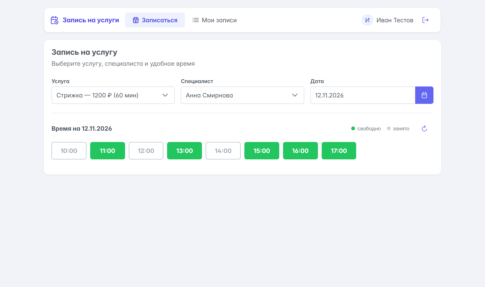
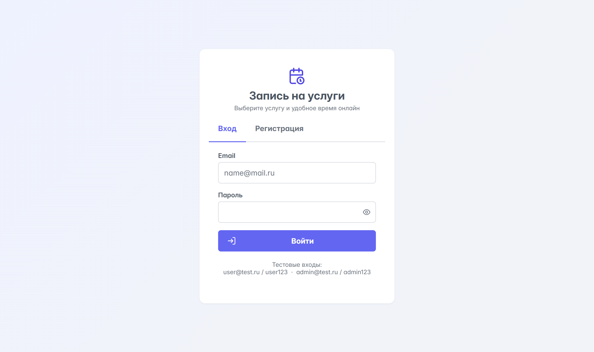
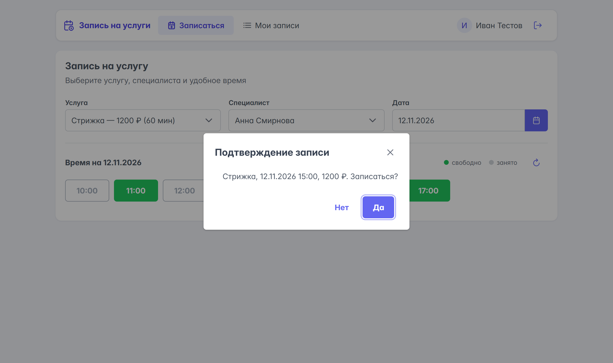
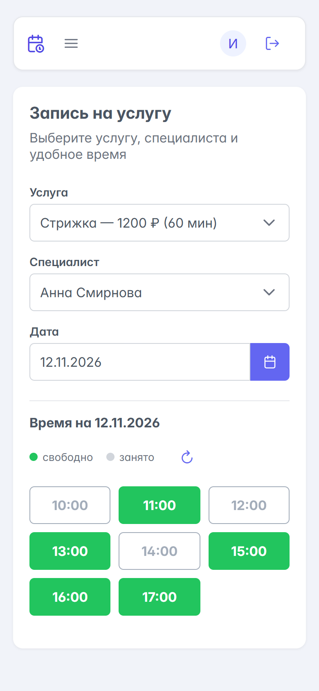
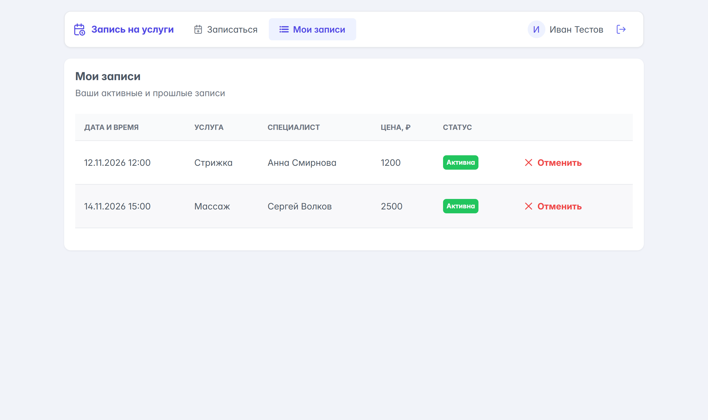
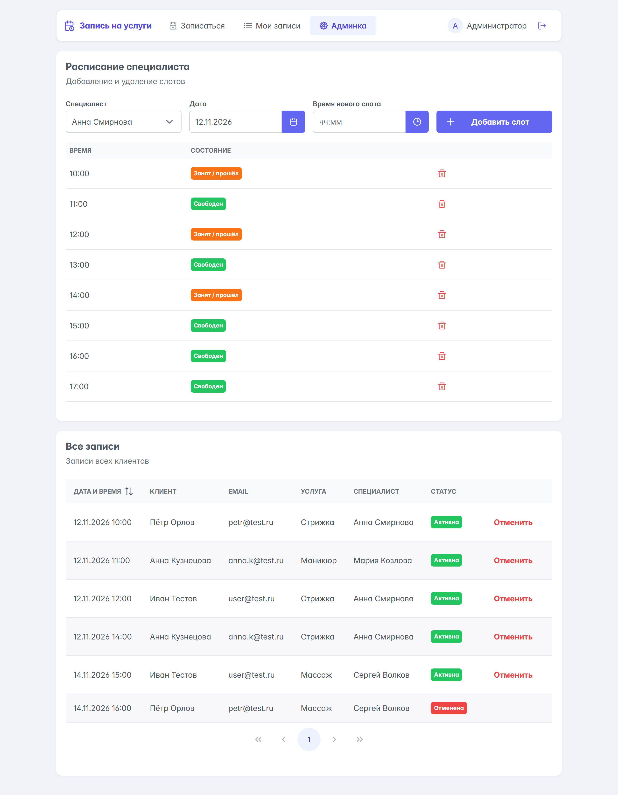
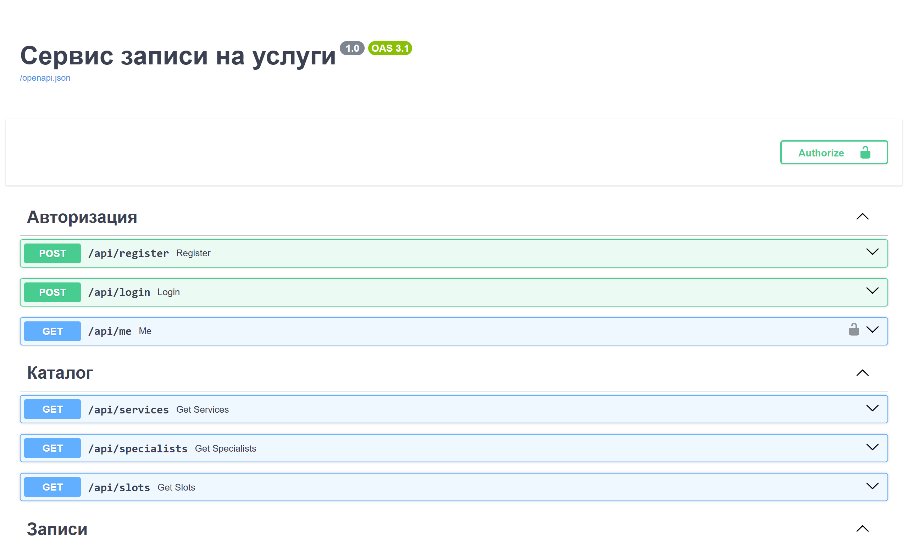
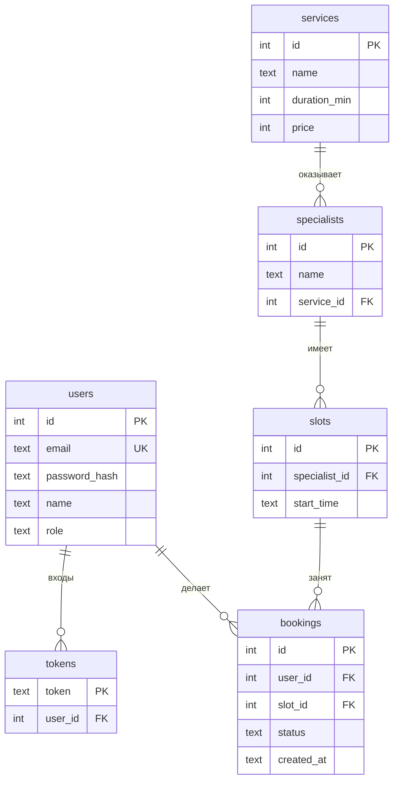

# Сервис записи на услуги

Веб-сервис для записи клиентов к специалистам (салон услуг): выбор услуги, специалиста и свободного времени, личный кабинет и административная часть.
Кейс 5 форума «Умная индустрия», направление «Программирование».

**Команда:** капитан Самойленко Виталий Денисович; Валерия, Мария, Александр.

Презентация: [docs/presentation.pdf](docs/presentation.pdf)



| Вход | Подтверждение | Мобильная версия |
|---|---|---|
|  |  |  |

| Мои записи | Админка | Документация API |
|---|---|---|
|  |  |  |

## Стек

| Часть | Технологии |
|---|---|
| Сервер (API) | Python 3.13, FastAPI, Uvicorn |
| База данных | SQLite (встроенный модуль `sqlite3`) |
| Клиент | React 18, PrimeReact 10, Vite |
| Документация API | Swagger, генерируется FastAPI автоматически |

## Запуск

Нужны Python 3.11+ и Node.js 18+.

**1. Сервер**

```bash
cd backend
python -m venv venv
venv\Scripts\pip install -r requirements.txt
venv\Scripts\python -m uvicorn main:app --reload --port 8000
```

При первом запуске создаётся файл `booking.db` с тестовыми данными.
Документация API: http://localhost:8000/docs

**2. Клиент** (в другом окне терминала)

```bash
cd frontend
npm install
npm run dev
```

Сайт: http://localhost:5173

После установки зависимостей оба приложения можно запустить одним файлом `start.bat`.

Чтобы вернуть базу в исходное состояние, остановите сервер и удалите `backend/booking.db`.

## Тестовые учётные записи

| Роль | Email | Пароль |
|---|---|---|
| Администратор | admin@test.ru | admin123 |
| Клиент | user@test.ru | user123 |

## Сценарий бронирования

1. Войти как `user@test.ru`.
2. На вкладке «Записаться» выбрать услугу, специалиста и дату (например, завтра).
3. Зелёные кнопки означают свободное время. Нажать на время и подтвердить запись.
4. Слот становится серым и недоступным, запись появляется на вкладке «Мои записи».
5. В «Моих записях» запись можно отменить, после этого слот снова свободен.
6. Войти как `admin@test.ru`. Во вкладке «Администрирование» видны все записи всех клиентов. Можно добавить слот специалисту или удалить свободный слот, и изменения сразу видны клиенту.

## Как выполнены критерии приёмки

| Критерий | Решение |
|---|---|
| Нельзя создать две записи на один ресурс и время | В БД есть уникальный индекс `one_active_booking_per_slot` на `bookings(slot_id)` для активных записей. Если два клиента нажмут одновременно, база пропустит только одну запись, второй придёт ответ `409 Это время уже занято`. Проверено одновременной отправкой двух запросов. |
| Доступ к личным данным ограничен авторизацией | Все запросы к записям требуют токен (`Authorization: Bearer ...`). Пользователь видит и отменяет только свои записи, админские методы возвращают `403` для обычного пользователя. Пароли хранятся в виде хеша PBKDF2 с солью. |
| Изменения расписания отражаются в клиенте | Слоты загружаются с сервера при каждом выборе специалиста или даты, есть кнопка «Обновить». После записи или отмены сетка перезагружается. |

## API

| Метод | Адрес | Доступ | Описание |
|---|---|---|---|
| POST | /api/register | все | регистрация, возвращает токен |
| POST | /api/login | все | вход, возвращает токен |
| GET | /api/me | авторизованный | текущий пользователь |
| GET | /api/services | все | список услуг |
| GET | /api/specialists?service_id= | все | специалисты услуги |
| GET | /api/slots?specialist_id=&date= | все | слоты на дату с признаком `is_free` |
| POST | /api/bookings | авторизованный | создать запись `{slot_id}` |
| GET | /api/my/bookings | авторизованный | мои записи |
| DELETE | /api/bookings/{id} | владелец или админ | отменить запись |
| GET | /api/admin/bookings | админ | все записи |
| POST | /api/admin/slots | админ | добавить слот `{specialist_id, start_time}` |
| DELETE | /api/admin/slots/{id} | админ | удалить слот без активной записи |

Подробная интерактивная документация: http://localhost:8000/docs

## Схема базы данных



## Структура проекта

```
booking/
├── backend/
│   ├── main.py           — все методы API
│   ├── db.py             — таблицы, тестовые данные, хеширование паролей
│   └── requirements.txt
├── frontend/
│   └── src/
│       ├── App.jsx       — меню и переключение страниц
│       ├── api.js        — запросы к серверу
│       └── pages/        — вход, запись, мои записи, админка
└── start.bat
```

## Тестовые данные

Услуги, специалисты, слоты и учётные записи придуманы командой и создаются кодом в `backend/db.py` (функция `seed`). Слоты генерируются на 7 дней вперёд с 10:00 до 17:00. Данные не содержат реальных персональных данных: имена специалистов и клиентов вымышленные, совпадения с реальными людьми случайны.

## Ограничения прототипа

- Упрощённая модель: у специалиста одна услуга, длительность слота 1 час.
- Токены бессрочные, выход только на стороне клиента.
- SQLite подходит для демонстрации. Для реальной нагрузки базу нужно перенести на PostgreSQL, логика уникального индекса останется той же.
